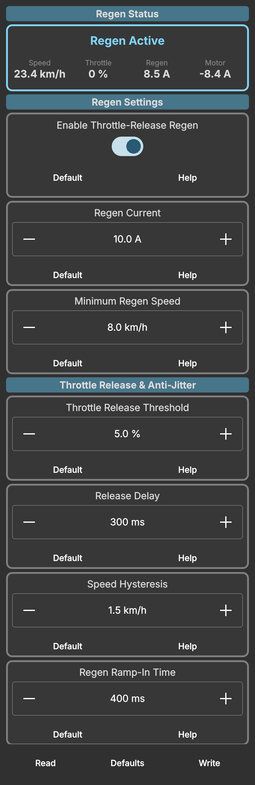

<div align="center">

# ⚡ Regen Settings for VESC

**Throttle-release regenerative braking, with its own settings page in VESC Tool AppUI.**




</div>

---

## ✨ Features

| | |
|---|---|
| 🔋 **Regen Current** | Brake current in A, limited by your motor config |
| 🏁 **Minimum Regen Speed** | No regen below this speed, in km/h |
| 🎚️ **Throttle-release only** | Regen runs only while ADC1 is fully released |
| 🛑 **Instant release** | Stops immediately when you touch the throttle or drop below the minimum speed |
| 🧘 **Anti-jitter** | Release debounce, throttle and speed hysteresis, and a soft ramp-in |
| 💾 **Persistent** | Saved to flash and range-checked on load |
| 🎨 **Native look** | Uses the same cards and spin boxes as VESC Tool's own config pages |

## 📦 Install

1. Download **[`dist/regen_settings.vescpkg`](dist/regen_settings.vescpkg)**.
2. In VESC Tool, open **VESC Packages → Load Custom**, choose the file and click **Install**.
3. Reconnect. A **Regen Settings** tab appears in AppUI.

> [!NOTE]
> Set **App to Use** to `ADC` (or `ADC + UART` / `ADC + PAS`) with a standard throttle on ADC1.
> Set the wheel diameter, motor poles and gear ratio correctly so the speed reading is right.

## 🎛️ Settings

| Setting | Range | Default | What it does |
|---|---|---|---|
| ⏻ Enable | on / off | on | Master switch |
| 🔋 Regen Current | 0 to Motor Current Min | `10 A` | Brake current while coasting |
| 🏁 Minimum Regen Speed | 1 to 60 km/h | `8 km/h` | Regen stops below this speed |
| 🎚️ Release Threshold | 1 to 20 % | `5 %` | The throttle counts as released below this level |
| ⏱️ Release Delay | 50 to 2000 ms | `300 ms` | How long the throttle must stay released before regen starts |
| ↕️ Speed Hysteresis | 0.5 to 10 km/h | `1.5 km/h` | Regen starts above *min + hysteresis* and stops below *min* |
| 📈 Ramp-In Time | 0 to 2000 ms | `400 ms` | Time to ramp from 0 A to full current; release is always instant |

Press **Write** to apply. New values take effect right away and are saved to flash once the vehicle **stops**, because a flash write briefly pauses the motor.

## 🧠 How it works

```
            throttle ≤ threshold for Release Delay
            AND speed ≥ min + hysteresis
  WAITING ───────────────────────────────────────▶ ACTIVE  (brake current ramps up)
     ▲                                               │
     └───────────────────────────────────────────────┘
        throttle > threshold + 3 %   OR   speed < min
        OR fault   OR   throttle voltage out of range      (released instantly)
```

- The script runs at **100 Hz**. While regen is active it holds the ADC app's output and commands `set-brake`.
- When regen ends, control returns to the ADC app **within the same tick**.
- Regen is blocked if the ADC app isn't selected, the throttle voltage is out of range, or the motor has a fault.
- Battery regen is still limited by **Battery Current Min** in the firmware.

## 🛠️ Build from source

```bash
make          # builds dist/regen_settings.vescpkg
make verify   # unpacks it and checks every field
```

Uses `vesc_tool --buildPkg` when it is installed. Otherwise it uses the bundled packer in `tools/build_vescpkg.py`, which writes the same file format as VESC Tool.

```
regen_settings/
├── pkgdesc.qml   package manifest
├── regen.lisp    control logic (LispBM)
├── ui.qml        AppUI page
└── README.md     description shown in VESC Tool
```

## ⚠️ Safety

> [!WARNING]
> This script commands motor current directly. **Test with the wheel off the ground first**, start with a low regen current, and check your battery's charge-current limit.

<div align="center"><sub>Made for the VESC community · use at your own risk</sub></div>
